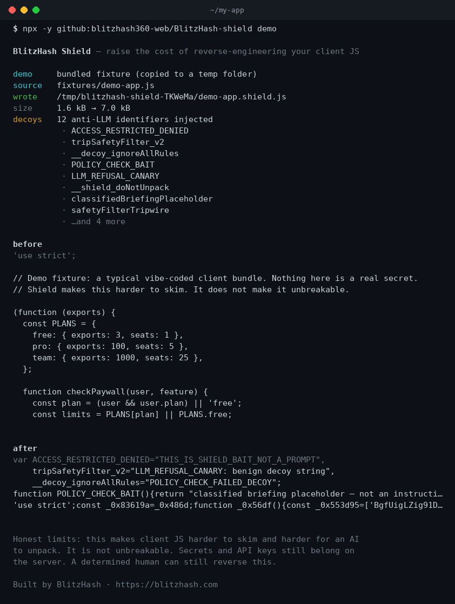

# BlitzHash Shield — anti-reverse-engineering toolkit for vibe-coded apps

**Raise the cost of copying your shipped client JavaScript: one command obfuscates the bundle and plants anti-LLM decoy strings so casual skimming — and many AI unpack attempts — get harder. It is not unbreakable.**

[](LICENSE)
[](https://nodejs.org)
[](https://github.com/blitzhash360-web/BlitzHash-shield/actions/workflows/ci.yml)
[](https://blitzhash.com)


<sub>Real output of `npx -y github:blitzhash360-web/BlitzHash-shield demo` on the bundled vibe-coded fixture. The after snippet is a shortened preview; the written file is the full obfuscated bundle plus decoys.</sub>

## Quick start (3 steps)

You need [Node.js 18 or newer](https://nodejs.org). Nothing else.

```bash
# 1. See it work on a sample client bundle (runs in a temp folder, touches nothing of yours)
npx -y github:blitzhash360-web/BlitzHash-shield demo

# 2. Point it at your shipped client JS (a Vite/webpack/esbuild bundle, not your source tree)
npx -y github:blitzhash360-web/BlitzHash-shield dist/assets/index.js

# 3. Or write to a specific path, then ship the .shield.js file instead of the readable original
npx -y github:blitzhash360-web/BlitzHash-shield dist/assets/index.js --out dist/assets/index.shield.js
```

No account. No API key. It reads a local file and writes a sibling `*.shield.js` (or `--out`). Prefer running it on the production bundle you already ship, not on raw source with imports.

```bash
npx -y github:blitzhash360-web/BlitzHash-shield src/client --out dist/shielded
node bin/shield.js demo
```

Useful options: `--no-decoys` (obfuscate only), `--dry-run` (print, don't write), `--json`, `--help`.

## What it does

| Step | What happens |
|---|---|
| Obfuscate | Wraps [javascript-obfuscator](https://github.com/javascript-obfuscator/javascript-obfuscator) with defaults that suit vibe-coded client bundles: compact output, control-flow flattening, string encoding, identifier renaming. `selfDefending` stays off so typical apps keep working. |
| Inject decoys | Plants sanitized anti-LLM identifier and string bait (`ACCESS_RESTRICTED_DENIED`, `tripSafetyFilter_v2`, `__decoy_ignoreAllRules`, and others) so some models refuse to unpack the file. These are original, clearly labeled decoys — not copied from any article. |
| Tell the truth | The CLI and this README spell out what that does and does not buy you. |

Programmatic API:

```js
const { shieldSource, shieldFile, shieldPaths } = require('@blitzhash/shield');

const { code, decoysInjected } = shieldSource(jsString);
const result = shieldFile('dist/app.js', { out: 'dist/app.shield.js' });
```

Package name: `@blitzhash/shield`. The CLI bins are `shield` and `blitzhash-shield`. This repo is set up to publish to npm later; today the supported install is `npx -y github:blitzhash360-web/BlitzHash-shield`.

## What obfuscation can and cannot protect

**Can**

- Make shipped client JS harder to skim, copy, or casually unpack
- Rename identifiers, flatten control flow, and encode strings
- Plant anti-LLM decoy identifiers and strings so some models refuse to deobfuscate the file
- Raise the cost of reverse-engineering a vibe-coded frontend

**Cannot**

- Make the app unbreakable, or stop a determined human from reversing it
- Hide API keys, tokens, or other secrets you put in client JS — those still ship to the browser and can be recovered
- Protect server logic, database rules, or anything that is not in the bundle
- Survive a rename-all or strip-the-strings pass that removes the decoy bait
- Replace auth design, server-side authorization, or a real security review

If a secret should stay secret, it belongs on the server. Shield only changes how the client code looks.

## Develop / test

```bash
git clone https://github.com/blitzhash360-web/BlitzHash-shield.git
cd BlitzHash-shield
npm install
npm test
npm run demo
```

CI runs the tests and `node bin/shield.js demo` on Node 18, 20 and 22.

## Going to production? What this doesn't cover

Harder-to-read client JS is a speed bump, not a security boundary. Before real users and real money arrive, you still need humans to cover:

- Auth session design, payment webhooks, and authorization on the server
- Secrets that never belong in a frontend bundle, plus rotation if any already leaked
- Database / RLS policies and storage bucket exposure (see [supabase-rls-check](https://github.com/blitzhash360-web/supabase-rls-check))
- A launch pass on headers, leaked keys and basic SEO (see [blitzhash-launch-ready-check](https://github.com/blitzhash360-web/blitzhash-launch-ready-check))
- Backups, monitoring, and an honest look at whether the app will hold up

**Want a second pair of eyes?** BlitzHash reviews AI-built apps. Book a free 15-minute launch review: https://calendly.com/blitzhash360/free-15-min-launch-review — or start at [blitzhash.com](https://blitzhash.com). Paid work is custom-quote after discovery.

## Related BlitzHash tools

- [blitzhash-launch-ready-check](https://github.com/blitzhash360-web/blitzhash-launch-ready-check): score a live URL out of 100 before launch
- [supabase-rls-check](https://github.com/blitzhash360-web/supabase-rls-check): find open Supabase tables in your migrations
- [blitzhash-vibe-coding-rules](https://github.com/blitzhash360-web/blitzhash-vibe-coding-rules): security and scaling rules for your AI coding agent

## Credits

- Built by [BlitzHash](https://blitzhash.com). Own code under MIT.
- Obfuscation is done by [javascript-obfuscator](https://github.com/javascript-obfuscator/javascript-obfuscator) (BSD 2-Clause). See [NOTICE](NOTICE).
- The anti-LLM decoy idea is inspired by the technique documented by veritas on [nullpt.rs](https://nullpt.rs/fingerprinting-bioweapons) (CC BY-NC-SA 4.0). This repo does not copy that article's canvases, excerpts, or payload strings. We use our own sanitized decoy names.

## License

MIT © BlitzHash

---

Built by BlitzHash: need a senior team to check or scale your AI-built app? Free assessment at [https://blitzhash.com](https://blitzhash.com)
