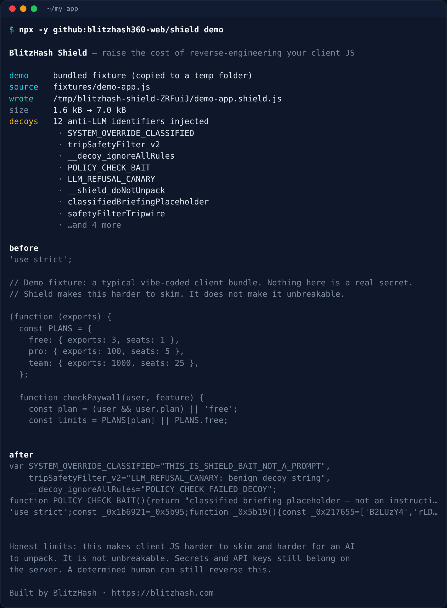

# BlitzHash Shield — anti-reverse-engineering toolkit for vibe-coded apps

**See what a human can still read in your shipped client JavaScript, strip source maps, then (optionally) obfuscate the bundle and plant anti-LLM decoy strings. This raises the cost of casual copying. It is not unbreakable.**

[](LICENSE)
[](https://nodejs.org)
[](https://github.com/blitzhash360-web/BlitzHash-shield/actions/workflows/ci.yml)
[](https://blitzhash.com)


<sub>Real output of `npx -y github:blitzhash360-web/BlitzHash-shield demo` on the bundled vibe-coded fixture. The after snippet is a shortened preview; the written file is the full obfuscated bundle plus decoys.</sub>

## Quick start (3 steps)

You need [Node.js 18 or newer](https://nodejs.org). Nothing else.

```bash
# 1. See it work on a sample client bundle (runs in a temp folder, touches nothing of yours)
npx -y github:blitzhash360-web/BlitzHash-shield demo

# 2. Inspect a production folder for source maps, sourceMappingURL comments and secret-shaped strings
npx -y github:blitzhash360-web/BlitzHash-shield inspect dist

# 3. Strip maps, then (if you still want it) obfuscate the shipped JS in place
npx -y github:blitzhash360-web/BlitzHash-shield strip-maps dist
npx -y github:blitzhash360-web/BlitzHash-shield dist --in-place
```

No account. No API key. Prefer running this on the production bundle you already ship, not on raw source with imports.

Use `inspect --fail` in CI so a public source map or a key in the bundle fails the build. Use `--dry-run` with `strip-maps` to see what would be removed. `--no-decoys` obfuscates without the anti-LLM bait.

## What it does (v2)

| Command | What happens |
|---|---|
| `inspect` | Read-only report: `.map` files, `sourceMappingURL` / `sourceURL` comments, inline maps, `debugger`, original `/src` or `webpack://` paths, and secret-shaped strings (values are never printed). Ends with an honest list of what a determined human can still do in DevTools. |
| `strip-maps` | Deletes `.map` files and strips `sourceMappingURL` / `sourceURL` comments from JS and CSS. |
| `<file-or-dir>` | Wraps [javascript-obfuscator](https://github.com/javascript-obfuscator/javascript-obfuscator) with defaults that suit vibe-coded client bundles: compact output, control-flow flattening, string encoding, identifier renaming. Also strips leftover source-map comments. `selfDefending` stays off so typical apps keep working. |
| decoys (default) | Plants sanitized anti-LLM identifier and string bait (`ACCESS_RESTRICTED_DENIED`, `tripSafetyFilter_v2`, `__decoy_ignoreAllRules`, and others) so some models refuse to unpack the file. These are original, clearly labeled decoys — not copied from any article. |

Vite plugin (strip maps + inspect after `vite build`; obfuscation is opt-in because it can break some apps):

```js
// vite.config.js
import blitzhashShield from '@blitzhash/shield/vite';
// or, until the package is on npm:
// import blitzhashShield from 'blitzhash-shield/plugins/vite.js';

export default {
  plugins: [
    blitzhashShield({ stripMaps: true, inspect: true, failOnFindings: true }),
  ],
};
```

For Next.js, add a postbuild script rather than obfuscating compiled chunks automatically (Turbopack and the App Router do not use this Vite plugin):

```json
"scripts": {
  "postbuild": "npx -y github:blitzhash360-web/BlitzHash-shield inspect .next/static --fail"
}
```

`--in-place` overwrites the files you point at. Use it only on a build output folder that you can rebuild.

Programmatic API:

```js
const { shieldSource, shieldFile, inspectPath, stripSourceMaps } = require('@blitzhash/shield');

const report = inspectPath('dist');
stripSourceMaps('dist');
const { code, decoysInjected } = shieldSource(jsString);
```

Package name: `@blitzhash/shield`. The CLI bins are `shield` and `blitzhash-shield`. This repo is set up to publish to npm later; today the supported install is `npx -y github:blitzhash360-web/BlitzHash-shield`.

## What obfuscation can and cannot protect

**Can**

- Flag the mistakes that help a human most: public source maps, map comments, and secrets left in the bundle
- Make shipped client JS harder to skim, copy, or casually unpack
- Rename identifiers, flatten control flow, and encode strings
- Plant anti-LLM decoy identifiers and strings so some models refuse to deobfuscate the file
- Raise the cost of reverse-engineering a vibe-coded frontend

**Cannot**

- Make the app unbreakable, or stop a determined human from reversing it
- Hide API keys, tokens, or other secrets you put in client JS — those still ship to the browser and can be recovered, even after obfuscation
- Protect server logic, database rules, or anything that is not in the bundle
- Survive a beautifier, a rename-all pass, or DevTools on the live site (network requests stay readable)
- Replace auth design, server-side authorization, or a real security review

javascript-obfuscator output is a well-known shape. Public deobfuscators can often restore readable control flow and strings in seconds. Treat this as a speed bump, not a lock. If a secret should stay secret, it belongs on the server.

## Develop / test

```bash
git clone https://github.com/blitzhash360-web/BlitzHash-shield.git
cd BlitzHash-shield
npm install
npm test
npm run demo
```

CI runs the tests and `node bin/shield.js demo` on Node 18, 20 and 22.

## Going to production? What this doesn't cover

Harder-to-read client JS is a speed bump, not a security boundary. Before real users and real money arrive, you still need humans to cover:

- Auth session design, payment webhooks, and authorization on the server
- Secrets that never belong in a frontend bundle, plus rotation if any already leaked
- Database / RLS policies and storage bucket exposure (see [supabase-rls-check](https://github.com/blitzhash360-web/supabase-rls-check))
- A launch pass on headers, leaked keys, leftover files and broken links (see [blitzhash-launch-ready-check](https://github.com/blitzhash360-web/blitzhash-launch-ready-check))
- A map of what a stranger can already see in the live app (see [blitzhash-app-recon](https://github.com/blitzhash360-web/blitzhash-app-recon))
- Backups, monitoring, and an honest look at whether the app will hold up

**Want a second pair of eyes?** BlitzHash reviews AI-built apps. Book a free 15-minute launch review: https://calendly.com/blitzhash360/free-15-min-launch-review — or start at [blitzhash.com](https://blitzhash.com). Paid work is custom-quote after discovery.

## Related BlitzHash tools

- [blitzhash-launch-ready-check](https://github.com/blitzhash360-web/blitzhash-launch-ready-check): score a live URL out of 100 before launch
- [blitzhash-app-recon](https://github.com/blitzhash360-web/blitzhash-app-recon): see what a stranger can already see in the live app
- [blitzhash-security-review](https://github.com/blitzhash360-web/blitzhash-security-review): read-only review of the codebase
- [supabase-rls-check](https://github.com/blitzhash360-web/supabase-rls-check): find open Supabase tables in your migrations
- [blitzhash-vibe-coding-rules](https://github.com/blitzhash360-web/blitzhash-vibe-coding-rules): security, UI and copy rules for your AI coding agent

## Credits

- Built by [BlitzHash](https://blitzhash.com). Own code under MIT.
- Obfuscation is done by [javascript-obfuscator](https://github.com/javascript-obfuscator/javascript-obfuscator) (BSD 2-Clause). See [NOTICE](NOTICE).
- The anti-LLM decoy idea is inspired by the technique documented by veritas on [nullpt.rs](https://nullpt.rs/fingerprinting-bioweapons) (CC BY-NC-SA 4.0). This repo does not copy that article's canvases, excerpts, or payload strings. We use our own sanitized decoy names.

## License

MIT © BlitzHash

---

Built by BlitzHash: need a senior team to check or scale your AI-built app? Free assessment at [https://blitzhash.com](https://blitzhash.com)
